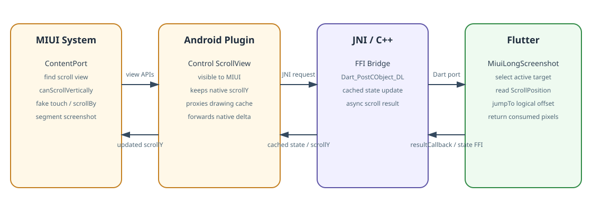
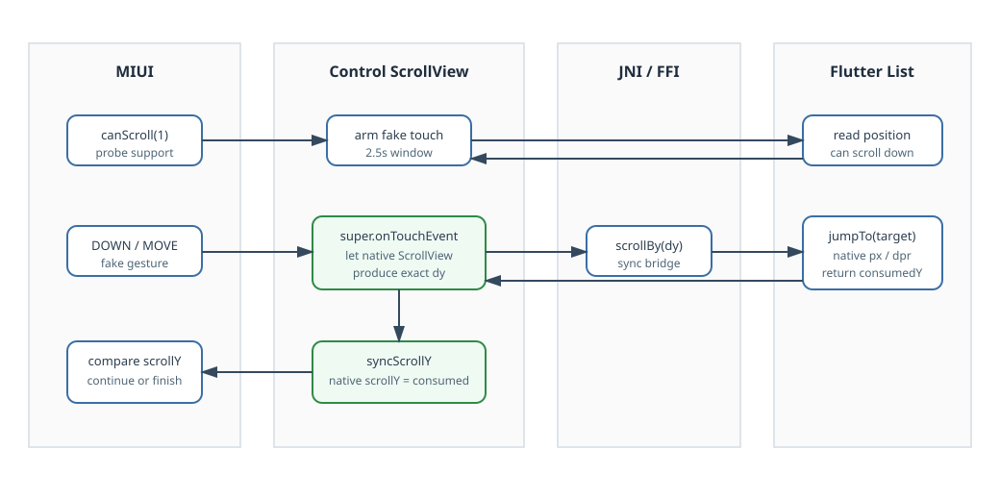

# miui_long_screenshot

`miui_long_screenshot` lets MIUI's system long screenshot tool drive a Flutter vertical scroll view. It does not generate screenshots by itself. Instead, it exposes a native Android `ScrollView` proxy that MIUI can discover and operate, then forwards the scroll command into Flutter.

The package targets Flutter 3.19+ and Android. Other platforms are no-ops.

## Usage

Add the dependency:

```yaml
dependencies:
  miui_long_screenshot: ^0.1.0
```

Wrap the scrollable page:

```dart
final controller = ScrollController();

MiuiLongScreenshot(
  controller: controller,
  child: ListView.builder(
    controller: controller,
    itemBuilder: (context, index) => Text('row $index'),
  ),
)
```

Passing `controller` is recommended. If it is omitted, the widget searches the wrapped subtree for a vertical `Scrollable`.

## Architecture



MIUI does not know how to scroll a Flutter `ListView` because the Android view tree only contains the Flutter container. The package adds one transparent native `ScrollView` over the Flutter content. That view is large enough and reports `canScrollVertically(1) == true` when the wrapped Flutter scroll view can still move.

The important components are:

- `MiuiLongScreenshot`: Dart widget that registers the current page and owns the Flutter-side scroll logic.
- `_MiuiLongScreenshotRegistry`: selects the visible active target, handles MethodChannel fallback, and receives FFI messages.
- `MiuiLongScreenshotPlugin`: Android plugin that installs the native control view and routes MIUI calls.
- `MiuiLongScreenshotControlView`: transparent native `ScrollView` discovered by MIUI. It maintains native `scrollY`, forwards scroll distance to Flutter, and proxies drawing cache calls to the real Flutter view.
- `NativeLongScreenshotJni` and `miui_long_screenshot.cpp`: synchronous bridge from Android to Dart using `Dart_PostCObject_DL` plus a Java callback latch.

## Scroll Flow



The normal MIUI flow is:

1. MIUI scans the Android view tree and finds the control `ScrollView`.
2. MIUI calls `canScrollVertically(1)`.
3. Android calls Dart through FFI. Dart checks the active Flutter `ScrollPosition`.
4. If scrolling is possible, Android arms a short fake-touch window.
5. MIUI sends a fake touch gesture to the native `ScrollView`.
6. The control view lets `super.onTouchEvent()` calculate the native scroll delta.
7. `onScrollChanged()` forwards the exact native `dy` to Dart.
8. Dart converts native physical pixels to Flutter logical pixels and calls `jumpTo`.
9. Dart returns the consumed native pixels and whether the list can still scroll down.
10. Android syncs the control view's `scrollY` to the consumed distance so MIUI's bottom detection stays correct.

This fake-touch path matters on MIUI versions that do not call `scrollBy()` directly. Manually interpreting `ACTION_DOWN` and `ACTION_MOVE` can over-scroll because MIUI sends both a large initial gesture and subsequent move deltas. The package uses native `ScrollView`'s own gesture math and forwards only the resulting `onScrollChanged` delta.

## Pixel Conversion

MIUI scroll values are physical pixels. Flutter scroll positions use logical pixels. The package converts:

```text
logicalDelta = nativeY / devicePixelRatio * scrollFactor
```

`scrollFactor` defaults to `1.0`. Keep it unchanged unless a page has a known device-specific mismatch.

## Performance Notes

The fast path is FFI:

- Android calls native C++.
- C++ posts a message to Dart with `Dart_PostCObject_DL`.
- Dart calculates scroll state and calls exported `resultCallback`.
- Java waits up to 100 ms with `CountDownLatch`.

There is a MethodChannel fallback for devices or builds where the native library is unavailable. During real MIUI long screenshot, logs should show `path=ffi` in `MiuiLongScreenshotPerf`.

The Android side waits briefly after scrolling before returning:

- First scroll after screenshot: 64 ms.
- Later scrolls: 16 ms.

This gives Flutter one frame to draw updated content before MIUI captures the next segment.

## Debugging

Watch logs:

```bash
adb logcat -s MiuiLongScreenshotPerf:D MiuiLongScreenshotRaw:D '*:S'
```

Query state:

```bash
adb shell am broadcast \
  -p your.application.id \
  -a io.github.steven12138.miui_long_screenshot.DEBUG \
  --es token miui-long-screenshot-adb \
  --es cmd state
```

Manually request a native scroll:

```bash
adb shell am broadcast \
  -p your.application.id \
  -a io.github.steven12138.miui_long_screenshot.DEBUG \
  --es token miui-long-screenshot-adb \
  --es cmd scroll \
  --ei y 900
```

## Publishing

Before publishing to pub.dev:

1. Replace `repository` and `issue_tracker` in `pubspec.yaml` with the public package repository.
2. Confirm the license owner is correct.
3. Run `flutter pub publish --dry-run` inside this package directory.
4. Publish with `flutter pub publish`.

## Limitations

- Android only; non-Android platforms are no-ops.
- Designed for vertical scroll views.
- Only one active scroll target is selected at a time. The most recently interacted visible wrapped target wins.
- Dynamic list height changes caused by late image loading can still affect stitching quality. The plugin allows one extra bottom probe after a real consumed scroll to reduce premature termination.
